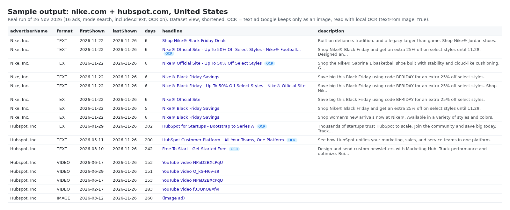

# Google Ads Transparency MCP & API

[](https://glama.ai/mcp/servers/Bilal10B/google-ads-transparency-mcp) [](https://glama.ai/mcp/connectors/io.github.Bilal10B/google-ads-transparency)

Track **any competitor's Google ads worldwide** — on Search, YouTube, Shopping, Maps and Google Play — from Google's official [Ads Transparency Center](https://adstransparency.google.com/), as clean JSON.

Use it as a regular Apify API (Python, JavaScript, cURL) or as an **MCP server** that AI agents (Claude, ChatGPT, Cursor, n8n, LangChain) can call directly.

In the EU and EEA you also get a unique bonus: the **official impression range per country and per platform**, plus the **audience-selection criteria** the advertiser used, published by Google under the EU Digital Services Act (DSA). Those ranges are not published for the US or the UK.

This repository documents the public [Apify Actor](https://apify.com/xsi/google-ads-transparency) and its MCP server. It does not contain the Actor's source code.

**$1 per 1,000 ads** ($0.001 per ad, ad copy included, no start fee; $0.70 per 1,000 on Apify GOLD plans). **$0.0015** for an ad with full EU details. A free Apify account includes **$5 of monthly credit**.

- Store: [apify.com/xsi/google-ads-transparency](https://apify.com/xsi/google-ads-transparency)
- MCP endpoint (Streamable HTTP): `https://xsi--google-ads-transparency.apify.actor/mcp`
- Demo: [How to track any competitor's Google Ads (and get EU impression data) with an API / MCP](docs/how-to-track-any-competitor-google-ads-api-mcp.md) ([version française](docs/comment-suivre-les-google-ads-dun-concurrent-api-mcp.md))



*Real run of 26 Nov 2026: `nike.com` + `hubspot.com`, United States, with ad copy (OCR on).*

## Who it is for

- **Marketers and e-commerce teams** who want to see which ads a rival is running now, in which markets, and with what copy.
- **Agencies** pitching or auditing a brand's Google presence in the US, UK, EU or elsewhere.
- **Ad-intelligence and AI-agent builders** who need a stable API or MCP tool, not a browser script.

## Why this one

- **Worldwide coverage** from the official Transparency Center: any country Google supports, including the US, UK, Germany, France and dozens more.
- **Ad copy** when Google's official preview has it: headline, description, visible URL, call-to-action, sitelinks, or the YouTube video ID of a video ad. Text ads that Google keeps only as an image are read with local OCR (+$0.001 only when text is found) and flagged `textFromImage: true`.
- **EU bonus:** official DSA impression ranges by country and platform, plus targeting criteria (demographics, locations, contextual signals, customer lists, topics of interest).
- **Ready-made signals on every ad (v2.1):** `daysActive`, `isWinningAd`, `isNewLaunch`, `detectedPromoCodes`, `detectedDiscounts`, plus one free `domain_summary` row per website (active, winning and new ads, format split, oldest ad, promo codes).
- **New-ad and stopped-ad alerts** you can schedule daily or weekly (stopped-ad rows are free).
- **MCP server** with four tools, so agents can ask “what is Nike running in the US this week?” without a custom integration.
- **$0.001 per ad** among the most-used Transparency Center Actors on the Apify Store as of 26 November 2026, with no start fee. Empty or failed results are not billed, and a run never exceeds your cost cap.

YouTube video *files* are not downloaded (YouTube's terms forbid it). You get the official video ID, the YouTube URL and, if you turn the option on, the thumbnail.

## Quick start (Apify API)

Get a token from [Apify Console → Integrations](https://console.apify.com/settings/integrations). A free account is enough.

### Python

```python
from apify_client import ApifyClient

client = ApifyClient("YOUR_APIFY_TOKEN")
run = client.actor("xsi/google-ads-transparency").call(
    run_input={
        "mode": "search",
        "queries": ["nike.com", "adidas.com"],
        "regions": ["US", "GB", "DE", "FR"],
        "includeDetails": True,
        "includeAdText": True,
        "maxAdsPerQuery": 2,
        "maxItems": 16,
    },
    timeout_secs=480,
    memory_mbytes=256,
    max_total_charge_usd=0.08,
)
for ad in client.dataset(run["defaultDatasetId"]).iterate_items():
    print(ad["query"], ad["region"], ad["advertiserName"], ad.get("headline"), ad.get("selectedRegion"))
```

### JavaScript

```js
import { ApifyClient } from 'apify-client';

const client = new ApifyClient({ token: 'YOUR_APIFY_TOKEN' });
const run = await client.actor('xsi/google-ads-transparency').call(
  {
    mode: 'search',
    queries: ['nike.com', 'adidas.com'],
    regions: ['US', 'GB', 'DE', 'FR'],
    includeDetails: true,
    includeAdText: true,
    maxAdsPerQuery: 2,
    maxItems: 16,
  },
  { timeout: 480, memory: 256, maxTotalChargeUsd: 0.08 },
);
const { items } = await client.dataset(run.defaultDatasetId).listItems();
console.log(items);
```

### cURL

Do not put the token in the URL (it ends up in logs). Use the `Authorization` header:

```bash
curl -X POST \
  "https://api.apify.com/v2/acts/xsi~google-ads-transparency/runs?timeout=480&memory=256&maxTotalChargeUsd=0.08" \
  -H "Authorization: Bearer YOUR_APIFY_TOKEN" \
  -H "Content-Type: application/json" \
  -d '{
    "mode": "search",
    "queries": ["nike.com", "adidas.com"],
    "regions": ["US", "GB", "DE", "FR"],
    "includeDetails": true,
    "includeAdText": true,
    "maxAdsPerQuery": 2,
    "maxItems": 16
  }'
```

Runnable copies of these examples are in [`examples/`](examples/).

## MCP client config (AI agents)

Transport: **Streamable HTTP**. Auth: your Apify token as a Bearer token.

```json
{
  "mcpServers": {
    "google-ads-transparency": {
      "url": "https://xsi--google-ads-transparency.apify.actor/mcp",
      "headers": {
        "Authorization": "Bearer YOUR_APIFY_TOKEN"
      }
    }
  }
}
```

Paste that into Cursor (`~/.cursor/mcp.json`), Claude Desktop (`claude_desktop_config.json`), or any client that supports remote MCP servers over Streamable HTTP.

### Tools

| Tool | What it does | Billing |
|---|---|---|
| `find_advertiser` | Company name or website → advertiser IDs (`AR…`), legal name, country, ad-count range | $0.003 per call with results; no match is free |
| `list_ads` | Ads of a domain, advertiser ID or name, filtered by country, format, platform and dates. Returns a `summary` plus token-lean rows (`verbose: true` for every key); OCR only with `includeOcr: true` | $0.003 + $0.001 per ad (+$0.001 per OCR text); empty results are free |
| `get_ad_details` | One ad: variants, countries, and — in the EU — impressions and audience selection | $0.003 + $0.0015 |
| `new_ads_since` | Ads first shown on or after a date — for a daily or weekly watch | $0.003 + $0.001 per new ad; “nothing new” is free |

Measured on 26 Nov 2026 (build 2.1.8): five timed `list_ads` calls answered in 3.3–8.6 s (nike.com US 3.3 s, hubspot.com 4.8 s, semrush.com 5.2 s, adidas.com 8.4 s, nike.com GB 8.6 s), plus 0.6–2.1 s for `initialize`. Text answers were 54% smaller than in v2.0.

## Example output

Real data from run [`biPCUmNEKOhNQP5oO`](https://console.apify.com/view/runs/biPCUmNEKOhNQP5oO) on 26 November 2026 at 10:48 (Europe/Brussels, 09:48 UTC). The query compared `nike.com` and `adidas.com` in the United States, United Kingdom, Germany and France, with details and ad copy, capped at 2 ads per brand and country (16 ads). The run took 46.8 seconds and billed 16 “ad-detail” events plus 13 “ad-copy” events ($0.045 at the list prices of that day; ad copy is now included in the ad price).

Google's own totals for these **global domains** (a brand may also advertise under a country domain, which is a separate query):

| | United States | United Kingdom | Germany | France |
|---|---|---|---|---|
| nike.com | 8,000–9,000 ads | 2,000–3,000 | 9,000–10,000 | 8,000–9,000 |
| adidas.com | 4,000–5,000 ads | 68 | 600–700 | 600–700 |

A Nike Black Friday text ad running in the US that day:

```json
{
  "advertiserName": "Nike, Inc.",
  "domain": "nike.com",
  "region": "US",
  "creativeId": "CR09898538327395532801",
  "format": "TEXT",
  "headline": "Nike® Golf Collection",
  "description": "Save big this Black Friday using code BFRIDAY for an extra 25% off select styles.",
  "displayUrl": "nike.com",
  "firstShown": "2026-11-22T05:02:42.000Z",
  "lastShown": "2026-11-26T09:13:25.000Z",
  "transparencyUrl": "https://adstransparency.google.com/advertiser/AR16735076323512287233/creative/CR09898538327395532801?region=US"
}
```

The US and the UK do not get official impression counts. The EU bonus shows up once you look at Germany or France. In the same run, a long-running Nike Shopping image ad in France (training socks) had an official floor of **10,000,000 impressions** in France, with no upper bound published by Google, including 450,000–500,000 on Shopping and 15,000–20,000 on YouTube. A Nike text ad sampled in Germany had only 0–1,000 impressions there, but **250,000–300,000** across the EU.

More of this run, trimmed, is in [`examples/sample-output.json`](examples/sample-output.json). The [demo article](docs/how-to-track-any-competitor-google-ads-api-mcp.md) walks through all 16 ads.

## Pricing

You only pay for results. Apify compute and proxy are included in these prices. There is no start fee.

| Event | FREE plan | BRONZE | SILVER | GOLD+ |
|---|---|---|---|---|
| **Ad** (ad copy included) | $0.001 | $0.0009 | $0.0008 | $0.0007 |
| Ad with EU DSA details (replaces Ad) | $0.0015 | $0.0013 | $0.0012 | $0.001 |
| OCR ad copy (image-only text ads, only when text is found) | $0.001 | $0.001 | $0.001 | $0.001 |
| Media file saved | $0.002 | | | |
| Advertiser record (advertiser mode) | $0.002 | | | |
| Monitored target checked (monitor mode) | $0.001 | | | |
| New-ad alert (monitor mode, details + copy included) | $0.005 | | | |
| MCP tool call (plus the ads it returns) | $0.003 | | | |

Prices as listed on 26 Nov 2026; the [Store page](https://apify.com/xsi/google-ads-transparency) is the reference. Never billed: empty results, status rows, summary rows, stopped-ad rows, duplicates, failed runs, invalid input. The "$0.01 minimum" shown in Apify Console is only the lowest *Max cost per run* you can set, not a fee: a run on a website without ads charged 0 events (run `h4dbATcj0vjr0bviz`).

## Modes

- `search` — list ads for a website, advertiser name or advertiser ID (`AR…`). Turn on *Include EU DSA details* and *Include ad copy* as needed.
- `advertiser` — find advertiser IDs and ad-count ranges per country. With a website it also answers “does this site run Google ads?” (`runsAds`).
- `details` — full data for official Transparency Center URLs you paste.
- `monitor` — schedule it daily or weekly; you get one alert per **new** ad and a free `STOPPED_AD` row when an ad stops. The first run only stores a baseline.

Queries can be domains (`nike.com`), names in any script, advertiser IDs, or URLs copied from the Ads Transparency Center.

## Disclaimer

This tool only reads **public** data from Google's Ads Transparency Center. It does not access any advertiser's private Google Ads account. Impression figures are official ranges published by Google under the EU DSA; they are typically available only after about 90 days, they are ranges rather than exact counts, and they are not published for non-EU countries. Always check the official ad page linked in `transparencyUrl`.

## License

The documentation and examples in this repository are under the [MIT License](LICENSE). The hosted Actor is a paid service on the Apify Store; using it is subject to [Apify's terms](https://apify.com/terms) and [Google's Ads Transparency Center terms](https://adstransparency.google.com/).


## Free workflows (n8n, Make, Clay)

Weekly watch of your competitors' Google ads → Slack or Notion: see [`workflows/`](workflows/README.md). Ready-to-import n8n files (weekly winning-ads digest for Slack; **Radar**: winning, new and stopped ads to Slack and Notion), plus Make and Clay guides.
